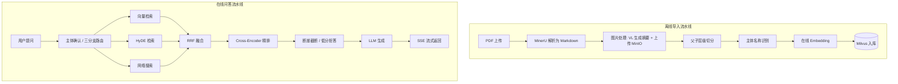

# 电磁感知知识库问答系统（RAG）

> 基于 **LangGraph** 编排的工程化检索增强生成（RAG）系统，面向电磁频谱感知领域文献，支持 PDF 文档的**自动解析入库**与**多轮流式问答**。全链路采用在线 API（阿里云百炼 + MinerU），无需本地部署大模型。

## 核心特性

- **双流水线编排**：LangGraph 实现「离线导入」「在线问答」两条有向图，支持条件路由与多路并行；
- **混合检索**：稠密向量（`text-embedding-v4`，COSINE）+ 稀疏检索（Milvus 内置 BM25），`WeightedRanker` 融合；
- **父子层级切片（small-to-big）**：小粒度子块向量化保证检索精度，命中后按 `parent_uid` 回取完整章节作为生成上下文；
- **多路召回**：原始向量检索、HyDE 假设文档检索、网络搜索（百炼 EnhancedSearch）三路并行，RRF 融合；
- **Cross-Encoder 精排**：在线 rerank 模型精细判别“能否直接回答问题”，断崖检测动态决定 Top-K；
- **实体对齐与确认分支**：别名/缩写自动构建，已确认 / 候选反问 / 无结果拒识三分支；
- **防幻觉机制**：绝对分数阈值（floor）低分拒答 + 答案节点对空参考文档硬拦截，实现“无可靠依据即拒答”；
- **SSE 流式输出**：逐 token 推送，支持后台任务 + 跨线程队列；MongoDB 存储多轮对话历史；
- **自动化评测**：检索用 Hit Rate / MRR / 章节召回率，生成用忠实度 / 相关性 / 正确性，支持版本回归；
- **全链路可观测**：trace/span 记录各节点耗时、状态与中间量。

## 系统架构



## 技术栈

| 模块 | 技术选型 |
| --- | --- |
| 编排框架 | LangGraph、LangChain |
| 文档解析 | MinerU（在线 API） |
| 大模型 / Embedding | 阿里云百炼：qwen-flash、qwen3-vl-flash、text-embedding-v4、qwen3-rerank |
| 向量数据库 | Milvus（dense + BM25 Function） |
| 文档数据库 | MongoDB（多轮历史、trace） |
| 对象存储 | MinIO（图片） |
| Web 框架 | FastAPI + Uvicorn，SSE 流式 |
| 部署 | Docker / Docker Compose（虚拟机） |
| 语言 / 包管理 | Python 3.11+、uv |

## 目录结构

```
.
├── config/            # 各模块配置（统一从 .env 读取）
├── processor/         # 核心流水线
│   ├── import_processor/   # 离线导入节点
│   └── query_processor/    # 在线问答节点
├── web/
│   ├── api/           # FastAPI 服务（导入 / 问答）
│   └── page/          # 前端页面（导入页 / 对话页）
├── utils/             # 通用工具（embedding、milvus、mongo、别名、追踪）
├── tool/              # 日志等基础工具
├── my_learn/          # 分步骤实现脚本与评测（可运行的学习/复现路径）
│   └── eval/          # 检索 / 生成评测脚本与测试集
├── .env.example       # 环境变量模板（不含真实密钥）
└── pyproject.toml
```

## 快速开始

### 1. 环境准备

```bash
# 建议使用 uv 创建虚拟环境
uv venv
uv pip install -r pyproject.toml   # 或按 pyproject 安装依赖
```

### 2. 启动中间件（Docker）

Milvus（standalone + etcd + minio + attu）、MongoDB、业务 MinIO 均通过容器部署，参见各镜像官方 Compose 配置。

### 3. 配置环境变量

```bash
cp .env.example .env
```

在 `.env` 中填入 MinerU Token、百炼 API Key，并按你的环境修改各服务地址（示例中为占位值）：

```ini
OPENAI_API_KEY=sk-xxxxxxxx
OPENAI_API_BASE=https://dashscope.aliyuncs.com/compatible-mode/v1
MINERU_API_TOKEN=sk-xxxxxxxx
MILVUS_URL=http://<VM_IP>:19530
MONGO_URL=mongodb://<VM_IP>:27017
MINIO_ENDPOINT=<VM_IP>:9000
```

### 4. 启动服务

```bash
# 导入服务（默认 8000）
python -m web.api.import_service
# 问答服务（默认 8001）
python -m web.api.query_service
```

浏览器打开导入页上传 PDF，入库完成后在对话页提问。

## 评测结果（12 题标注集，含 1 题拒答）

| 阶段 | 指标 | 结果 |
| --- | --- | --- |
| 检索 | Hit Rate@8 | 1.0 |
| 检索 | MRR | ≈ 0.94 |
| 检索 | 平均章节召回率 | ≈ 0.83 |
| 生成 | 忠实度 Faithfulness | ≈ 0.97 |
| 生成 | 答案相关性 Relevancy | 1.0 |
| 生成 | 答案正确性 Correctness | ≈ 0.97 |


## License

[MIT](LICENSE)
